# GolfMonitor

<p align="center">
  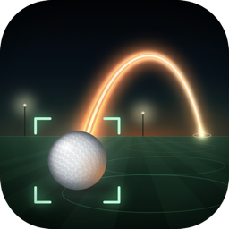
  &nbsp;&nbsp;
  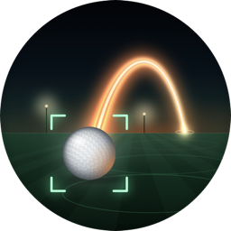
</p>

A launch monitor and swing analyzer that runs entirely on your iPhone, with an
Apple Watch remote. Put the phone on a tripod, press record (on the phone or
the watch), set up, take practice swings, hit the ball, press stop. GolfMonitor
finds the real strike, measures it, and shows the numbers on both screens.

- **One-button routine.** A single continuous recording covers everything.
  Practice swings are detected and ignored. The shot is the swing during which
  the teed ball disappears. See [Recording a shot](#recording-a-shot).
- **No separate ball-detection step.** The bundled ball detector runs in the
  background, locks onto the ball (green brackets in the viewfinder) and uses
  its measured size to calibrate distances automatically.
- **Launch numbers and swing analysis.** Ball speed, launch angle, carry,
  apex, hang time and descent from a face-on camera, plus tempo and eight
  swing phases from body pose. See [What it measures](#what-it-measures).
- **Apple Watch remote.** Live camera preview, start/stop, club picker and the
  result on your wrist, with haptics for each state.
- **Swings library, Swing Studio, Insights, a Carry Challenge** and a
  tour comparison. See [Features](#features).
- **Fully on-device.** Core ML, Vision and AVFoundation only. No account, no
  server, no network calls, no third-party packages.

## Screenshots

<table>
  <tr>
    <td align="center">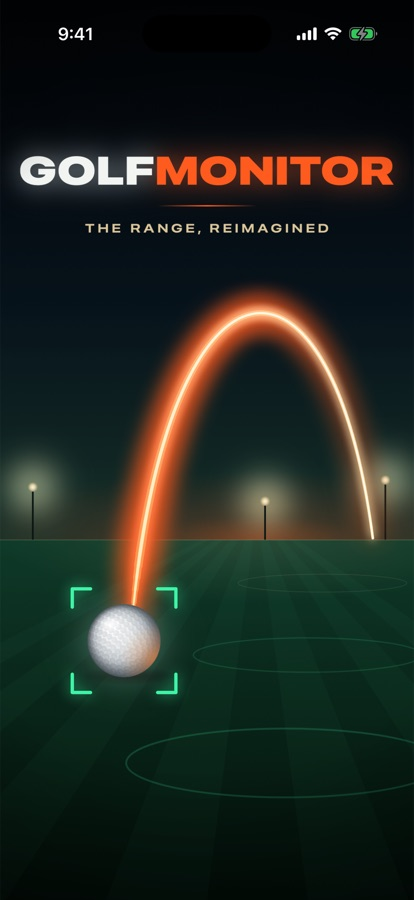<br><sub>Launch intro</sub></td>
    <td align="center">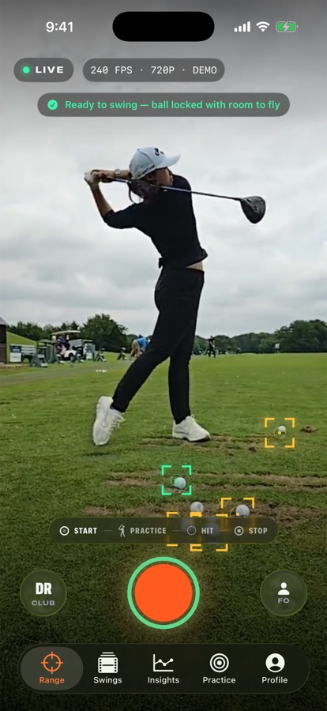<br><sub>Range · ready to swing</sub></td>
    <td align="center">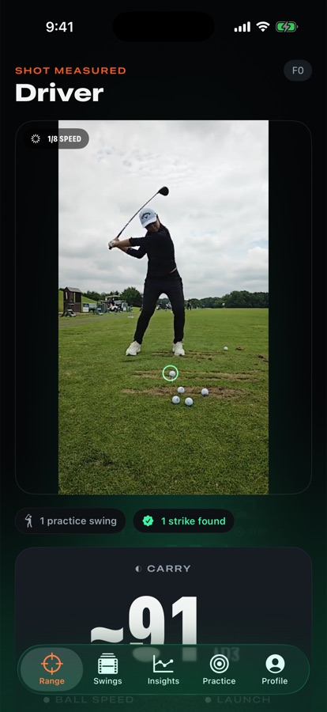<br><sub>Result · 1/8-speed replay</sub></td>
    <td align="center">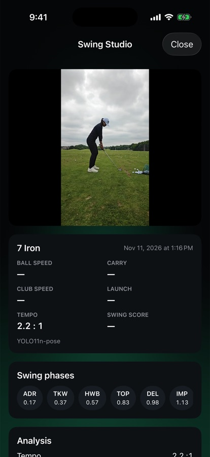<br><sub>Swing Studio</sub></td>
  </tr>
  <tr>
    <td align="center">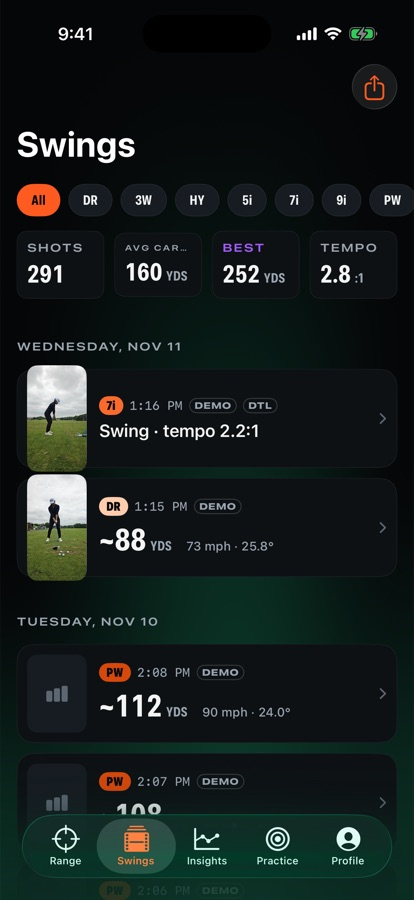<br><sub>Swings library</sub></td>
    <td align="center">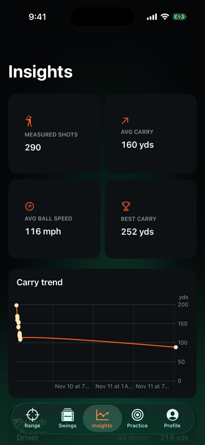<br><sub>Insights</sub></td>
    <td align="center">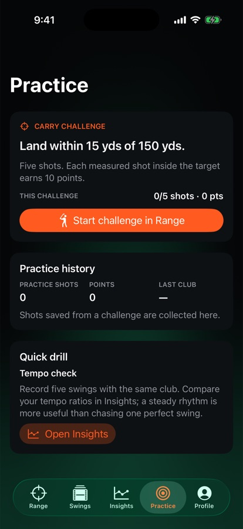<br><sub>Practice · Carry Challenge</sub></td>
    <td align="center">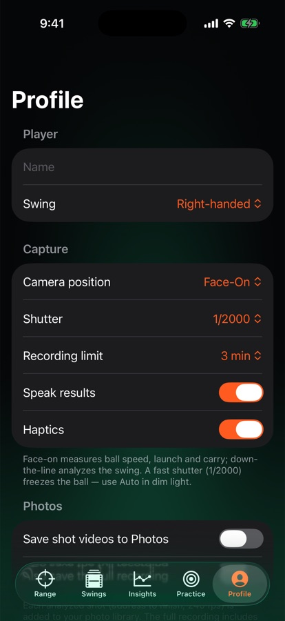<br><sub>Profile</sub></td>
  </tr>
</table>

<table>
  <tr>
    <td align="center">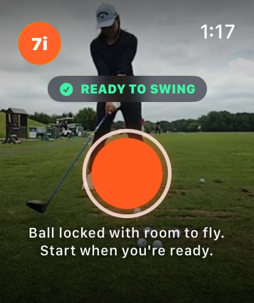<br><sub>Watch · ready to swing</sub></td>
    <td align="center">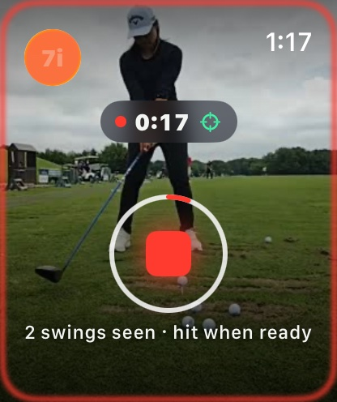<br><sub>Watch · recording, ball locked</sub></td>
    <td align="center">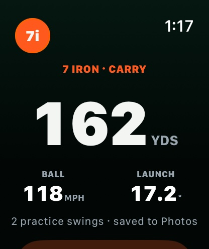<br><sub>Watch · result</sub></td>
  </tr>
</table>

<sub>iPhone Simulator with the bundled CC0 demo session and demo library (`-gm.demo`); watch screens use `-gm.mockState`.</sub>

## Run it

1. Open `GolfMonitor.xcodeproj` in Xcode 26.
2. In **Signing & Capabilities**, choose your team for the **GolfMonitor** and
   **GolfMonitorWatch** targets. If you change bundle IDs, keep the watch ID as
   `<phone id>.watchkitapp` and update `WKCompanionAppBundleIdentifier` in
   `GolfMonitorWatch/Info.plist` to match.
3. Select the **GolfMonitor** scheme and your iPhone, then Run. The watch app is
   embedded in the iPhone app (`GolfMonitor.app/Watch/`) and installs on the
   paired watch automatically. Check the iPhone **Watch** app › Available Apps
   if it doesn't appear. To debug the watch UI, run the **GolfMonitorWatch**
   scheme on the watch.

Requires iOS 18+ (every iPhone that runs it records 240 fps) and watchOS 10+.

**Simulator:** the iPhone Simulator has no camera, so a virtual camera loops a
bundled CC0 range session (setup → practice swing → strike) and "recording"
feeds that session through the real pipeline. Launch arguments for hands-free
checks:

```
-gm.skipOnboarding -gm.autostart 6     # record 6 s, stop, analyze, reveal
-gm.reset -gm.demo -gm.tab library     # demo library
-gm.noSplash                           # skip the launch intro
```

On the watch: `-gm.autostart 7` presses Start and then Stop over
WatchConnectivity, and `-gm.mockState result` shows a canned screen
(DEBUG builds only).

## At the range

```
   TARGET ───────────────────────────►   ball flies across the frame

             ●  ball (teed or on the mat)
        2–3 m
   ┌─┐
   │▯│  phone on a tripod, side-on (face-on to you), lens at ball height
   └┬┘
```

- Face-on (camera looking at your chest) measures **ball speed, launch angle,
  carry, apex, hang time and descent**, plus tempo. Down-the-line gives swing
  analysis (tempo, phases) only.
- Keep the ball in view with ~2 m of open space in front of it. A fast shutter
  (Profile › Shutter, 1/2000 by default) freezes the ball; switch to Auto in
  dim light.
- Keep the whole swing in frame, from address to finish.

## Recording a shot

One recording covers the whole routine. You don't tell the app which swing
was the real one; it works that out after you press stop.

### The routine

**With the Apple Watch (best):**

1. Tee the ball and step back. Wait for **READY TO SWING** on the watch
   (it taps your wrist when the ball locks).
2. Stand at the ball and press **Start** on the watch.
3. Set up and **hold still for a second or two**.
4. Swing. Take practice swings first if you like, with a short pause between
   each.
5. Hold your finish or watch the ball, then press **Stop**.

**Phone only:**

1. Tee the ball and wait for the record button's ring to turn **green**
   ("Ready to swing").
2. Press **record**, walk to the ball and set up.
3. **Pause for a moment at address** so walking up and swinging don't run
   into each other.
4. Swing, then watch the ball for a second or two.
5. Walk back and press **stop**. The recording also stops on its own at the
   recording limit (Profile › Recording limit, 3 minutes by default), or if
   you leave the app.

The numbers then appear on the phone, are read out loud ("165 yards carry.
Ball speed 120.") and show up on the watch.

### Ready to swing

Before you press record, both screens show whether a recording started now
is likely to be caught and measured. On the phone it's the hint at the top
and the record button's ring, which turns green when ready and is readable
from the tee. On the watch it's the status pill and the line under the
button. It's advice only: you can always start.

| Phone / watch shows | Meaning | Fix |
|---|---|---|
| **Ready to swing** (green ring) | A ball is locked, it has room to fly, and there's enough light | Start |
| **Ready · swing only** (green ring) | Down the Line view: the swing will be analyzed, not the ball | Switch to Face-On for ball numbers |
| **No ball locked** | No ball has been seen sitting still yet | Tee a ball in view and step back for ~1.5 s |
| **Move ball** | Every locked ball is in the last quarter of the frame on the target side (the right for a right-hander, the left for a left-hander), so it would leave the frame before it's tracked | Aim the phone or move the ball so there's room in front of it |
| **Too dark** | The frame is very dark at the fixed fast shutter | Add light, or set Profile › Shutter to Auto |

### What the app is looking for

| Step | What it detects | What it needs from you |
|---|---|---|
| Ball lock | A ball that sits still in the same spot for three detector passes, half a second apart | About **1.5 s** with the ball still and nobody standing over it. The lock carries over into the recording and survives you walking past it |
| Swing | A burst of movement **0.3–4 s** long. A pause separates one swing from the next | A moment of stillness before and after the swing. Walking up and swinging with no pause gets split at the slowest moment in between |
| You at the phone | Movement right at the start of the recording, and at the end when stop was pressed on the phone | Nothing. This is ignored, so walking to the ball and back never counts as a swing |
| Shot | The swing during which the locked ball disappears for good (gone for 0.6 s, or 0.2 s if the recording stops right after) | A ball locked **before** you take the club back |
| Practice swing | Every other swing (the ball stays put) | Nothing. Take as many as you like |

While recording, the strip at the bottom of the Range screen counts what has
been seen so far (**N SWINGS**, **SHOT ✓**). The watch shows the same:
"N swings seen · hit when ready", then "Shot detected — tap stop when you're
done." One recording can hold several shots (up to six are analyzed). Every
struck ball is saved as its own shot.

### If something goes wrong

| You see | It means | Try |
|---|---|---|
| "No swing was found in the recording…" | No swing-shaped movement at all, outside the walk to and from the phone | Keep the whole swing in frame. Pause briefly before and after the swing. Don't stop the recording mid-swing |
| "Swing analyzed" / "No ball strike found · swing saved" | A swing was found but no locked ball left during it, so you get tempo and phases only | Wait for the green brackets **before** swinging. If you tee the ball after pressing record, give it ~1.5 s to lock. Use face-on |
| "Strike found" / "Strike found — ball flight unclear" | The ball left, but it wasn't tracked in enough frames after impact | More light, a faster shutter, open space in front of the ball |
| "Down-the-line view analyzes the swing…" | Camera position is set to Down the Line | Switch to Face-On (FO) for ball numbers |

## What it measures

| Number | How | Trust |
|---|---|---|
| Ball speed | Line fit (RANSAC) through the ball's positions in the frames after impact; pixels → metres from the ball's measured diameter (42.67 mm) | ● measured |
| Launch angle | Elevation of the same fitted velocity (side view = vertical plane) | ● measured |
| Carry, apex, hang time, descent | Drag + Magnus flight model with the club's *typical* spin | ◐ estimate, roughly ±10 % |
| Club speed, smash | Ball speed ÷ the club's typical smash factor | ◐ estimate |
| Tempo, backswing, downswing | Takeaway → top → impact, from body pose and the measured impact frame | ● measured |
| Swing phases | Address, top, impact and finish from body pose (Apple Vision); takeaway, halfway back, delivery and release in between | ● / ◐ |
| Spin, side angle, offline | Not measurable from one side-on camera | — |

14 clubs, Driver to Lob Wedge, each with a typical loft and spin for the
flight model. The Range screen defaults to 7 Iron; the last club selected on
the Range screen, watch, or video import is remembered.

## Features

**Range** (main tab)
- **Ready to swing** indicator: a hint and a green record-button ring when a
  recording started now is likely to be measured (see
  [Ready to swing](#ready-to-swing)).
- Live viewfinder at 240 fps with a format badge (e.g. 240 FPS · 1080P), a
  status pill (LIVE / REC) and ball-lock brackets.
- **CLUB** picker and a Face-On / Down-the-Line toggle. Both lock while
  recording.
- Record button with a ring that fills toward the recording limit, a
  recording clock, and a red glow around the screen while recording.
- Routine strip (START → PRACTICE → HIT → STOP) with live swing and shot
  counts.
- Analyzing screen with progress through "Finding your shot", "Measuring ball
  flight", "Reading your swing" and "Saving". Analysis can be cancelled, and
  it keeps running briefly if the phone locks.
- **Result screen:**
  - "New personal best" (per club, by carry), "Shot measured", "Strike found"
    or "Swing analyzed".
  - A 1/8-speed slow-motion loop of impact with the ball tracer drawn in
    sync.
  - Big carry number, ball speed and launch.
  - Tiles for club speed, apex, hang time, descent, tempo and backswing.
  - Chips for practice swings counted, strikes found and Saved to Photos.
  - **Next shot**, **Swing Studio** and **Discard** buttons.
- **Voice readout** of the result ("Speak results", on by default).

**Swings** (library)
- Every shot, newest first and grouped by day, with a thumbnail, club, carry,
  speed and launch, or tempo for swing-only shots.
- Import videos from Photos or Files. Choose the club, camera view and
  handedness; swings are analyzed on-device and added to the library.
- Filter by club. A summary strip shows shots, average carry, best and tempo.
- Swipe to favourite or delete. The long-press menu has **Open in Swing
  Studio** and **Compare with tour**.
- Export every shot as CSV (always in mph and yards).

**Swing Studio**
- The shot video with the ball path and an optional body-pose skeleton drawn
  over the moving video.
- 2D torso lean, knee bend, head movement and hip sway estimates when enough
  body landmarks are visible. These are image-plane observations, not 3D
  measurements or coaching diagnoses.
- Metrics grid.
- Eight phase chips (Address, Takeaway, Halfway Back, Top, Delivery, Impact,
  Release, Finish). Tap one to jump to that estimated moment and see its full
  name and timestamp. The compact chip labels are app abbreviations; the phase
  sequence follows the commonly used GolfDB eight-event taxonomy, with
  intermediate phases estimated between detected events.
- Tempo, backswing and downswing, rated against tour tempo (~3:1).

**You vs PGA Tour**
- Carry, ball speed, club speed, smash, launch and apex next to tour averages
  for the same club (Driver to Pitching Wedge).

**Insights**
- Measured shots, average carry, average ball speed and best carry.
- A carry trend chart of the last 20 measured shots.
- Average carry by club.

**Practice**
- **Carry Challenge:** five shots aimed at 150 yds; each measured shot that
  lands within 15 yds scores 10 points. Start it from Practice; the Range
  screen shows the target until you tap **End**.
- Practice history: shots, points and last club.
- A tempo drill suggestion.

## Posture coach roadmap

The goal is useful swing feedback from an ordinary iPhone video without
claiming measurements the camera cannot support. Keep the distinction clear:
**observed** means visible in this view; **estimated** means inferred from
noisy 2D landmarks. Never turn a low-confidence estimate into a confident
fault diagnosis.

### Good candidates for phone-only development

These are observable in a single, steady view and can be useful when the
golfer is fully in frame. Ship them only with capture-quality checks and
validation across real users, phones, lighting and camera views.

1. **Capture guidance and pose confidence**
   - Guide the user to keep the whole body and club in frame, use a steady
     phone, and choose a supported face-on or down-the-line view.
   - Detect missing or frequently occluded joints, a golfer too small in frame,
     and unstable framing. Show a clear "can't measure this clip" state rather
     than filling gaps with invented values.
   - Show which landmarks support a metric and suppress it when confidence or
     visibility is insufficient.

2. **Phase timing and rhythm**
   - Improve and expose address, top and impact timing, backswing/downswing
     duration, tempo ratio, and variation across repeated swings.
   - Mark phases as estimated and let users correct a marker when detection is
     wrong. Report consistency only across clips with usable pose and timing.

3. **View-specific 2D movement**
   - Describe movement in image coordinates, normalized to visible body size:
     for example, head or hip center moving left/right in a face-on clip.
   - Show the measurement over the video and its time range, and compare swings
     only when camera view, framing and club are reasonably comparable.
   - Use neutral language such as "head position moved 6% of torso length
     toward image-right during the backswing," not "your head sway is wrong."
     Screen direction is not automatically target direction.

4. **Simple, transparent feedback**
   - Let users review a measurement, see the frames/landmarks behind it, and
     compare two swings side by side or phase by phase.
   - Offer optional drills only for repeatable observations, explain why a
     drill is suggested, and let users dismiss or correct the observation.
   - Track trends for the same golfer only after checking that capture setup
     and confidence are comparable.

### Not reliable from one ordinary phone view alone

Do not present these as measured facts or use them for automated pass/fail
coaching without a validated method and additional evidence:

- True 3D joint positions, exact joint angles, or depth from a single 2D view.
- Pelvis/shoulder rotation in degrees, separation ("X-factor"), or precise
  rotational sequence. A projected angle changes with camera placement and
  cannot resolve motion toward/away from the camera.
- Weight transfer, pressure under each foot, ground-reaction force, balance
  loading, or center-of-mass travel in real-world units. Visible sway is not a
  measurement of force or pressure.
- Clubface angle, attack angle, swing path, or hand/club path based only on
  body landmarks.
- Universal claims that one posture or movement pattern is correct for every
  golfer, or injury/medical diagnoses.

These may become research directions with multi-view video, calibrated depth
or external sensors, plus ground-truth validation. An iPhone's availability of
depth hardware on some models does not by itself make fast-swing biomechanics
accurate.

### Reliability gates before calling anything "coaching"

- Validate each metric against manually labeled video or a suitable reference
  system; publish its expected error and the camera views it supports.
- Test repeated recordings of the same swing/setup to measure repeatability,
  and test different bodies, clothing, handedness, lighting and backgrounds.
- Calibrate confidence so low-quality clips are rejected rather than shown
  with misleading precision. Keep estimates visually and verbally distinct
  from directly measured quantities.
- Start with descriptive feedback and comparison. Add normative ranges or
  prescriptive coaching only when evidence supports those ranges.

**Apple Watch**
- **Ready / Recording:**
  - The live camera preview (about 4 fps) fills the screen, with a red border
    while recording.
  - Status pill: READY TO SWING or what's missing before you start, then
    the recording time.
  - Big start/stop button with a ring for the recording limit.
- **Analyzing:** progress ring with the current step.
- **Result:**
  - Carry, ball speed, launch and smash, or the reason there's no ball data
    and your tempo.
  - The practice swing count and a **Next shot** button.
- **Club picker:** tap the club name in the toolbar.
- **Haptics** for start, stop, result, errors and the camera becoming ready.
- **Ball-lock tap:** a tap when a newly teed ball locks, before or during a
  recording. It comes once per ball: stepping over the ball and away again
  doesn't repeat it, and several balls locking together give one tap. While
  recording, a lock icon sits next to the timer.
- When the watch starts a recording, the phone switches to the Range screen.
  The GolfMonitor app must be open on the iPhone (see Limitations).

**Profile** (settings)

| Setting | Options | Default |
|---|---|---|
| Swing | Right-handed / Left-handed | Right-handed |
| Camera position | Face-On / Down the Line | Face-On |
| Shutter | Auto, 1/1000, 1/2000, 1/4000 | 1/2000 |
| Recording limit | 1, 2, 3, 5, 10 min | 3 min |
| Speak results | on / off | on |
| Haptics | on / off | on |
| Save shot videos to Photos | on / off | off |
| Also save the full recording | on / off | off |
| Speed | mph / km/h | mph |
| Distance | yards / meters | yards |

Profile also shows:
- **Apple Watch:** connection status.
- **Data:** shot count and video storage, **Export shots (CSV)** and **Delete
  all shots**.
- **Privacy & AI:** ball detector and body pose run on device, and the
  network is never used.

**Launch intro:** the launch screen opens straight into a ~2 s intro. The
lock brackets snap onto the ball and the shot's tracer flies across a
floodlit range, then it fades into the app. Tap to skip; Reduce Motion gets
a plain fade.

**First launch:** three onboarding pages cover tripod setup, the one-button
routine, and privacy, with handedness and the Save-to-Photos choice. After
that the app asks for camera access.

## How it works

```
camera (240 fps, 420f) ─┬─▶ HEVC recording (temp file)
                        ├─▶ SceneMonitor @30 Hz ── motion energy + ball presence
                        │       └─ GolfDetector (Core ML) locks stationary balls ~2×/s
                        └─▶ WatchPreviewStreamer ── 4 fps JPEG ─▶ Apple Watch
stop ─▶ ShotFinder: swings = motion bursts (not at the phone); shot = swing where a locked ball vanished
     ─▶ ClipExporter: cut [impact − 2.4 s, impact + 1.4 s] (no re-encode)
     ─▶ SwingAnalyzer: LaunchMeasurer (ball speed & launch) → FlightModel (carry…)
                       + body pose (Vision) → swing phases & tempo
     ─▶ ShotStore (clip, analysis.json, thumbnail) ─▶ Photos (optional) ─▶ reveal + watch
```

The app icons (iPhone and watch) and the launch artwork are drawn in code. Run
`swift scripts/render-art.swift` to re-render them into the asset catalogs.

More detail: [docs/ARCHITECTURE.md](docs/ARCHITECTURE.md). Model training:
[ml/README.md](ml/README.md).

## Tests

102 unit and integration tests, including the full pipeline on 240 fps CC0
fixtures (`GolfMonitorTests/Fixtures`, among them a synthetic session with a
practice swing followed by the real strike).

```
⌘U in Xcode, or:
xcodebuild test -project GolfMonitor.xcodeproj -scheme GolfMonitor \
  -destination 'platform=iOS Simulator,name=iPhone 17 Pro'
scripts/run-tests.sh            # same tests, injected straight into the app
                                # (for machines where xcodebuild's test runner can't connect)
```

## Limitations

- One phone camera can't see spin or left/right direction, so carry uses
  typical spin for the club and there is no offline number.
- A ball can only count as hit if it was locked before the swing. Swing
  within a second of teeing up and you get a swing-only analysis.
- Ball tracking needs the ball in frame for at least 2–3 frames after impact
  (240 fps, good light, fast shutter). If it fails, the shot is still saved
  with swing analysis and the reason is shown.
- The camera only runs while GolfMonitor is open on the iPhone. iOS doesn't let
  a watch bring an app to the foreground. Keep the app open on the tripod
  (the screen stays awake while the camera is live).
- The watch app has no background runtime. With your wrist down, watchOS
  can pause it. Haptics, including the ball-lock tap, are only felt while
  GolfMonitor is on the watch screen. A tap whose news is more than a few
  seconds old is skipped rather than played late.
- There is no import of existing videos yet: analysis runs on recordings
  made in the app.
- Bundled detector models derive from Ultralytics YOLO (AGPL-3.0), so the app
  must stay open source.
